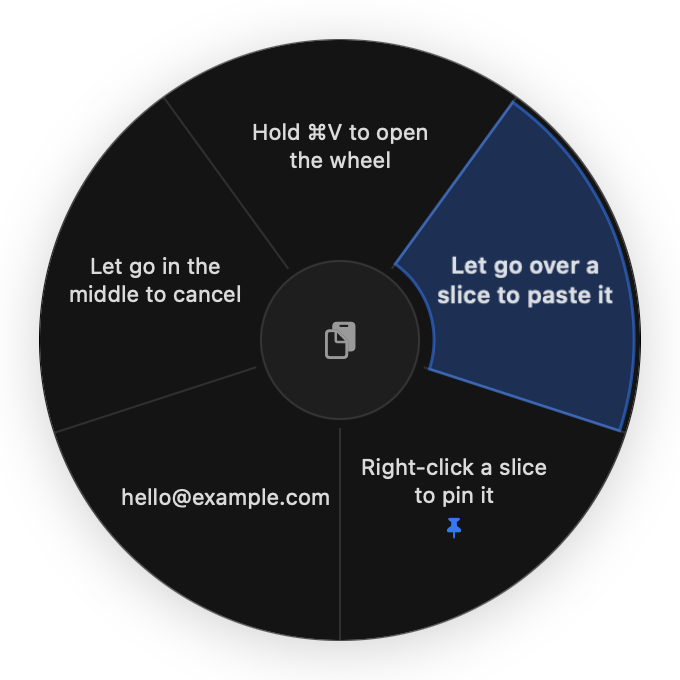

# Clipboard Wheel

A radial clipboard picker for macOS. **Tap ⌘V** and it pastes like normal. **Hold ⌘V** and a glass wheel of your recent copies pops up at your cursor. Move toward a slice and let go to paste it.

<p align="center">
  
</p>

## Install

1. Download **Clipboard-Wheel-0.1.0.zip** from the [latest release](https://github.com/DavidGoren7/clipboard-wheel/releases/latest), unzip it, and drag **Clipboard Wheel** into your Applications folder.
2. Open it. The app isn't notarized by Apple, so the first time macOS says it can't check it for malware. Click **Done**, then go to **System Settings → Privacy & Security**, scroll down, and click **Open Anyway** next to Clipboard Wheel.
3. Follow the welcome window to allow **Accessibility** (see [Permissions](#permissions)).

Requires macOS 14 or later.

## How it works

- **Tap ⌘V**: normal paste, exactly like macOS.
- **Hold ⌘V**: the wheel opens. Move the mouse toward a slice, then let go of the keys to paste it.
- **Let go in the middle** (or press **Esc**): cancel, nothing is pasted.
- **Right-click a slice** while the wheel is open: pin or unpin it. Pinned items are never overwritten.

The wheel grows one slice per item (2 items = halves, 3 = thirds, 4 = quarters…) up to a maximum you set in Settings (default 8). Once it's full, a new copy **overwrites the item you haven't used for the longest, in that same slot**, so everything else stays where your hand expects it. Copying something that's already on the wheel just refreshes it.

Text shows as a short label and images as thumbnails. Copies that password managers mark as private are never saved or shown.

### Settings

Open Settings from the wheel icon in the menu bar.

| Setting | Options |
|---|---|
| Wheel contents | History + pinned (default), history only, pinned only |
| Max slices | 2–12 (default 8) |
| Wheel position | At the cursor (default), or screen center (the mouse snaps to the middle and goes back afterward) |
| Hold delay | How long you hold ⌘V before the wheel opens |
| Feedback | Sound tick and trackpad haptic as you move between slices |
| Launch at login | On by default |

The menu bar icon also has **Pause** (hands ⌘V back to macOS and stops recording copies), **Pin current clipboard**, **Clear history**, and **Quit**. Opening the app again from Spotlight also shows Settings.

In **history only** mode, pinned items are kept but hidden and pinning is off. In **pinned only** mode, the wheel shows just your pins and new copies don't change it (use **Pin current clipboard** to add more). Pasting from the wheel pastes plain text, without formatting.

## Permissions

Clipboard Wheel needs **Accessibility** permission (System Settings → Privacy & Security → Accessibility) so it can see ⌘V and paste for you. It asks on first launch. If macOS asks whether Clipboard Wheel may read the clipboard, choose **Allow**.

Everything stays on your Mac: items are stored in `~/Library/Application Support/ClipboardWheel/`. Nothing is sent anywhere.

## Building from source

Requirements: macOS 14 or later and Xcode 16 or later.

```bash
git clone https://github.com/DavidGoren7/clipboard-wheel.git
cd clipboard-wheel
open ClipboardWheel.xcodeproj
```

Then press ⌘R. Or build a release copy, install it in Applications, and launch it:

```bash
scripts/install.sh
```

To keep the Accessibility permission across rebuilds, sign with your Apple ID: copy `Config/Local.xcconfig.example` to `Config/Local.xcconfig` and put your team ID in it (Xcode → Settings → Accounts shows it). Without it, the app is signed "to run locally" and macOS may ask for Accessibility again after each rebuild.

The project file is generated from `project.yml` with [XcodeGen](https://github.com/yonaskolb/XcodeGen). After changing `project.yml`, run `xcodegen generate`. The app icon is drawn by `swift scripts/make-icon.swift`, and `scripts/install.sh --show-wheel` opens the wheel with sample items for 30 seconds (that's how `docs/wheel.png` was captured).

The wheel logic (slots, pinning, eviction, slice math) lives in `Packages/ClipboardWheelCore` and can be tested without Xcode:

```bash
cd Packages/ClipboardWheelCore && swift test
```

## License

MIT. See [LICENSE](LICENSE).
